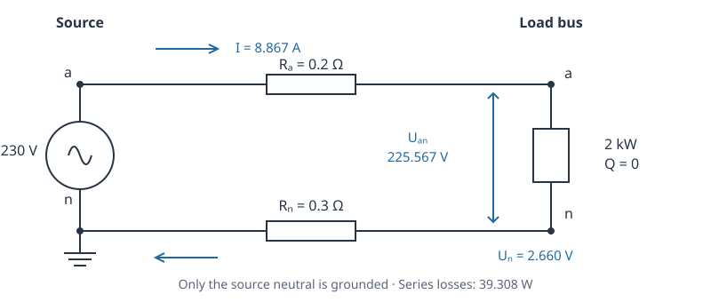

# Tutorial: build, verify and reuse an exact IVR model

This tutorial starts with a two-wire feeder whose solution can be calculated by
hand. It then checks conductor specialization, demand reuse, generator prices
an inverter's internal budget, a fixed regulator and voltage-dependent demand. Finally it deliberately violates a bound and
adds an earth-current path that invalidates the reduction certificate.

The learning objective is to distinguish **physical correctness**, **equivalent
representation** and **computational reuse**. None implies global optimality.
Read [the motivating examples](ivr_examples.md) for the engineering questions
and [the equations](ivr_theory.md) for the mathematical assumptions.



*Figure 1. Analytical operating point of the tutorial service. Values are rounded;
all equation checks use unrounded phasors.*

## 1. Reproduce the environment and case

From a checkout of FormulationLab, prepare the test environment and run the
standalone tutorial:

```sh
julia --project=test -e 'using Pkg; Pkg.develop(path="."); Pkg.instantiate()'
julia --project=test examples/tutorial_exact_ivr.jl
```

The examples use FormulationLab, JuMP and Ipopt. Ipopt is a caller/test dependency;
loading FormulationLab alone does not select a nonlinear solver. No proprietary
solver, external feeder file or service is needed. Documentation builds execute
the same teaching functions. The outputs below come from execution, rather than
manually maintained result tables. Last digits may vary by solver version.

```@example exactivr
using FormulationLab, Ipopt, JuMP
include(joinpath(pkgdir(FormulationLab), "examples", "tutorial_exact_ivr.jl"))
const T = ExactIVRTutorial
net = T.two_wire_case()
net["line"]["service"]
```

There are two ordered terminals, `["a", "n"]`, at both buses. Only the **source**
neutral is ideally grounded. Source phasors are 230 V and 0 V with zero angles
(angles are radians). The service has inline absolute conductor resistances
0.2 Ω and 0.3 Ω, zero reactances/mutual terms/shunts, and 40 A ratings on both
conductors. The load consumes 2000 W and 0 var between phase and neutral.
Downstream bounds are 180–260 V phase-neutral and at most 30 V neutral-ground.

The example uses a native dictionary. Dictionary acceptance does not imply
external schema validation. For file input, use `read_bmopf("network.json")`,
inspect its retained parser diagnostics, then check formulation applicability.
No example repairs a real feeder's source accounting or unsupported controls.

## 2. Build and solve the declared problem

```@example exactivr
full = build_opf(net, IVRNLP(objective=:source_import);
                 optimizer=Ipopt.Optimizer)
result = solve_ivr_nlp_opf(full; solver_options=T.SOLVER_OPTIONS)
@assert result.solve.optimal
(status=result.solve.termination_status, source_import_W=result.objective)
```

The script uses `tol=constr_viol_tol=1e-10`, `acceptable_iter=0` and
`max_iter=600`. These are explicit settings for these small examples, not
recommended defaults for every network. `LOCALLY_SOLVED` meets this API's strict
solver acceptance; `ALMOST_LOCALLY_SOLVED` does not. Unaccepted results publish
empty candidate dictionaries and a `NaN` objective. Check status before using
the candidate. A local solver status is not a global certificate.

## 3. Check the physics and the analytical answer

```@example exactivr
physical = physical_residuals(full.network, result)
point = ACPoint(voltage=result.voltage_candidate, currents=result.current_candidate)
encoded = ivr_nlp_point_report(full, point)
@assert physical.passed && encoded.passed
(SI_maxima=physical.maxima,
 model_violation=encoded.max_constraint_violation,
 reconstruction_error_pu=encoded.max_reconstruction_residual_pu)
```

These checks answer different questions. `physical_residuals` evaluates the SI
network equations and assessed limits independently of the formulation's
stamping. Its default tolerances are ``10^{-5}`` V, ``10^{-6}`` A and
``10^{-3}`` VA (W/var residuals share the power tolerance); unassessed items
prevent `passed=true`. `ivr_nlp_point_report` binds observations and evaluates
the actual JuMP constraints, using a default ``10^{-7}`` tolerance in the
model's normalization. These residuals have different units and are not
interchangeable. Neither check certifies the objective is globally minimal.

For this resistive unity-power-factor case,
``u^2-230u+0.5(2000)=0``. The high-voltage root gives the load phase-neutral
voltage; the 180 V lower bound excludes the other root.

```@example exactivr
u_exact = (230 + sqrt(230^2 - 4*0.5*2000))/2
I_exact = 2000/u_exact
U_n_exact = 0.3I_exact
loss_exact = 0.5I_exact^2
v = result.voltage_candidate
@assert isapprox(v[("demand","a")]-v[("demand","n")], u_exact; atol=1e-6)
@assert isapprox(v[("demand","n")], U_n_exact; atol=1e-6)
@assert isapprox(result.objective, 2000+loss_exact; atol=1e-5)
(phase_neutral_V=u_exact, neutral_ground_V=U_n_exact,
 current_A=I_exact, loss_W=loss_exact)
```

Line currents are available under `(:line_from,"service")` and
`(:line_to,"service")`; they are positive **into** the line at each endpoint.
The grounded source-neutral current uses an explicitly unobserved placeholder.
Do not interpret that placeholder as the return-conductor current: the latter
is the neutral entry in the line current vector.

## 4. Compare full and specialized representations

```@example exactivr
reduced = build_opf(net, IVRNLP(objective=:source_import,
                              specialization=:conductor_difference);
                    optimizer=Ipopt.Optimizer)
r_reduced = solve_ivr_nlp_opf(reduced; solver_options=T.SOLVER_OPTIONS)
T.check_result(reduced, r_reduced)
@assert reduced.numerical_diagnostics[:specialization] == :conductor_difference
@assert ivr_nlp_point_report(reduced, point).passed
@assert ivr_nlp_point_report(full, T.point(r_reduced)).passed
@assert isapprox(result.objective, r_reduced.objective; atol=1e-5, rtol=1e-7)
(full_real_variables=num_variables(full.model),
 reduced_real_variables=num_variables(reduced.model),
 certificate=reduced.numerical_diagnostics[:specialization_report].code)
```

The specialized model retains the neutral voltage and all original operating
limits. Each solved state is tested in the opposite model without optimizing
or fitting it. Run the same comparison for two-, three- and four-wire cases:

```@example exactivr
T.reduction_examples()
nothing # hide
```

The three-/four-wire examples are three-line unbalanced trees built by
`examples/ivr_compiler_cases.jl`. Their total nominal load is 3000 W + 750 var;
the three-wire loads are delta, while the four-wire loads are wye with explicit
neutral returns. Line mutual impedances are retained. These are distinct
physical cases, so their source-import values need not be equal. The meaningful
comparison is full versus reduced **within** each case.

## 5. Reuse the model for a changed demand

Changing demand defines a new operating problem with the same equipment.
Use the update API rather than editing `reduced.network` by hand:

```@example exactivr
update_ivr_loads!(reduced, Dict("house" => (p=[3000.0], q=[0.0])))
r_3000 = solve_ivr_nlp_opf(reduced; solver_options=T.SOLVER_OPTIONS)
T.check_result(reduced, r_3000)
@assert net["load"]["house"]["p_nom"] == [2000.0]
(import_W=r_3000.objective,
 assemblies=reduced.numerical_diagnostics[:assembly_count],
 updates=reduced.numerical_diagnostics[:update_count])
```

P and Q must both be supplied, in watts and vars, with the existing channel
arity. The build owns its snapshot: `net` remains unchanged. The following
experiment uses 1, 2 and 3 kW and compares each reused solution against a fresh
build of an independently edited input copy. It checks variable identity,
objective agreement and both supplied-point directions.

```@example exactivr
T.reuse_example()
nothing # hide
```

The API avoids electrical reassembly; it makes no automatic warm-start or
factorization-reuse promise. Equipment, source phasors and per-unit bases remain
fixed. A failed input-validation batch does not mutate the build, but backend
failures do not have a transactional rollback guarantee.

## 6. Change generator prices and inspect an inverter budget

For generators, the corresponding API accepts partial P/Q-box and price updates:

```julia
update_ivr_generators!(build, Dict("der" => (cost=[0.5],)))
```

`T.dispatch_example()` attaches a 0–600 W single-phase generator, with Q fixed
to zero, to the original service. The source is explicitly priced at
0.2 currency/kWh. The example changes the generator price from 0.1 to
0.5 currency/kWh on the same build and independently reconstructs the objective
from source and generator powers.

```@example exactivr
T.dispatch_example()
nothing # hide
```

With `objective=:cost`, the snapshot objective is a **cost rate**, currency/h;
there is no implicit time step. Price changes do not affect a `:source_import`
objective. Inverters are a different component family: their capability and
price changes currently require a fresh build.

The next example uses a single-phase inverter with 600 W PCC availability,
500 W internal active-power budget, 0.2 + j0.1 Ω series filter and zero filter
shunt. Both terminal current limits are 10 A, its apparent-power limit is
1000 VA, and PCC reactive power is fixed to zero. It checks the copper-loss
identity independently from the reported powers and filter current.

```@example exactivr
T.inverter_example()
nothing # hide
```

PCC injection must be below internal injection because of filter loss. This
example has no controller, external DC grid or battery energy state. `prime_mover`
is descriptive; it does not add an energy balance or an implicit P/Q restriction.
Three-leg PCC ratings and internal delta-coil quantities require the distinct
conventions explained in [the inverter contract](ivr_nlp.md).

## 7. Make a bound fail and observe a legitimate fallback

A useful negative check keeps the original physical state fixed while changing
one limit. Tightening the neutral cap from 30 V to 1 V must reject the state
with 2.660 V neutral displacement. This checks the retained neutral quantity
without relying on solver convergence or diagnosing global infeasibility.

The second experiment introduces a downstream phase-earth shunt of 1 mS.
This changes the physical problem: the two conductor currents no longer need
sum to zero. The requested specialization must fall back to full IVR and retain
the shunt. The full problem is then solved and independently checked.

```@example exactivr
T.refusal_examples()
nothing # hide
```

`:bus_shunt` is a specialization diagnostic, not an unsupported-component
error. Other full-IVR networks may similarly fall back for meshes, multiple
sources, switches or transformers. In contrast, unsupported load laws
or control profiles cause an applicability refusal.
See [the coverage matrix](coverage.md) before importing a new device family.

## 8. Check a fixed regulator and its output rating

Replace the service line with a `single_phase_autotransformer`, using the same
ordered phase/neutral maps at both ends. Its fixed type-B `tap_ratio = 1.04`
means an ideal voltage gain of 1.04. The example includes no leakage or
excitation, so the independently expected output is 239.2 V, current is
`2000/239.2` A, and source import is 2000 W. Both side-current ratings start at
10 A. The exact implementation and assertions are in `T.regulator_example`.

```@example exactivr
regulator = T.regulator_example(); nothing
```

The helper then lowers only the output phase-current rating to 8 A. Both the
built-model evaluator and independent physical auditor reject the unchanged
state. It also verifies full-IVR fallback when specialization is requested.
No tap is optimized. For type A, the native ideal gain is `1/tap_ratio`; see
[fixed regulator conventions](ivr_nlp.md#Fixed-regulators-and-conductive-bonds)
for conductive-bond observations and grounding ambiguity.

## 9. Compare demand laws at the same voltage

A voltage reduction changes the demand itself for current, impedance, ZIP and
exponential models. Compare them at a **fixed 207 V** coil voltage, with nominal
values 2000 W and 300 var at 230 V. This keeps the physical voltage identical
across cases, so the different powers come entirely from the load law.

```@example exactivr
load_laws = T.load_law_example(); nothing
```

The ZIP example uses active fractions `(0.2, 0.3, 0.5)` and reactive fractions
`(0.4, 0.5, 0.1)` in Z/I/P order; exponential powers use exponents 0.4 and 2.7.
The helper checks the tabulated powers and current against independently
calculated factors. These fixed nonzero source coils require no magnitude
auxiliaries or additional voltage bounds. At an unfixed bus, a positive lower
bound on the actual load-coil voltage is required; see the
[domain and data contract](ivr_nlp.md#Voltage-dependent-load-laws).

These cases share nominal demand, but represent **different physical models**.
Their objective values should not be treated as a full/reduced formulation
comparison or evidence of algorithmic improvement. Voltage-law coefficients and
nominal powers require a fresh build when changed; the existing demand-update
API applies only to declared constant-power loads.

## 10. Keep a physical boundary and reduce its pendant region

Add a 2 mS phase-earth shunt at bus `b1` of a three-line four-wire feeder.
The upstream line carries an earth-return contribution, so the whole-network
zero-sum certificate correctly declines. Lines `l2` and `l3`, downstream of
`b1`, still feed only zero-sum connections.

```@example exactivr
region = T.region_example(); nothing
```

The helper requests `specialization=:conductor_regions`, checks the selected
lines and retained boundary, and evaluates each solved point in the opposite
model. It explicitly verifies a nonzero upstream conductor-current sum while
the selected downstream line has zero sum. The model loses four real current
variables, retaining all voltages, original KVL, boundary KCL, shunt physics
and physical limits. `b1` is not fixed or grounded by the transformation.

This example demonstrates a larger applicability domain, not a timing benefit.
Inspect `region.report.regions`, `.retained_lines` and `.barriers` to see the
certificate. Transformers, switches, mesh cores and mixed conductor ports can
similarly remain physical while eligible attached trees are specialized; see
the [regional contract](ivr_nlp.md#Pendant-regions-inside-a-larger-network).

## 11. Substitute an exact impedance current

Change the two-wire load to constant impedance with 2 kW nominal consumption
at 230 V. Its conductance is `2000/230^2` S. With the same 0.5 ohm loop, the
analytical coil voltage is `230/(1 + 0.5*2000/230^2)` V. The helper requests
`linear_elimination=:impedance_loads`, verifies the analytical current, and
checks the solved physical states in both models.

```@example exactivr
impedance = T.impedance_elimination_example(); nothing
```

Two real current variables disappear, but the load-current result remains
available. This is an exact constitutive substitution. It does not apply to
constant-power loads, and nominal impedance changes still require rebuilding.

## 12. Preserve the bound at an eliminated intermediate bus

Split the original service into two equal, unshunted segments with no device at
the intermediate bus. Request `linear_elimination=:passive` together with
`specialization=:conductor_difference`. The compiler eliminates the intermediate
voltage coordinates and independent currents of one incident line, retaining
expressions for every original voltage/current/power observation.

```@example exactivr
series = T.series_elimination_example(); nothing
```

The helper tightens only the intermediate neutral-voltage limit to half its
solved magnitude. Both the compiled model and independent physical auditor
reject the unchanged state. Merely reconstructing that voltage after solving
would be insufficient: its bound must constrain the optimization itself.
Charged pi sections and device/ground boundaries are outside this certificate.

## 13. Resolve a stiff finite ground

Replace the ideal source-neutral ground with a finite susceptance of
``-10^{10}`` S, and use the impedance load from Section 11. The circuit has
the analytical current

```math
I=\frac{230}{0.5+230^2/2000+1/Y_g},\qquad V_n=I/Y_g.
```

Although ``V_n`` is very small, the ground current is finite. Request
`ground_scaling=:voltage` to express this free voltage in a numerically suitable
coordinate. The helper composes it with conductor and impedance elimination,
checks the analytical voltage, and then perturbs it by ``10^{-3}/Y_g`` V.
That perturbation creates a 1 mA KCL error without changing any supplied current.

```@example exactivr
ground = T.finite_ground_example(); nothing
```

The old normalized model check accepts this perturbed state. The scaled model
and the independent SI audit both reject it. This illustrates why solver
termination and small normalized residuals alone cannot certify physical
accuracy. Scaling retains the finite shunt and all original observations;
it does not replace it with ideal grounding or loosen a tolerance.

## 14. Extend the experiment without changing its meaning

For a larger study, record the input digest and every deliberate data change;
retain failed solves and explicit fallback reasons; compare accepted objectives
and physical states before timing; and distinguish construction, update and
solve times. Use `examples/benchmark_ivr_compiler.jl` for the synthetic ablation
and `examples/benchmark_ivr_dispatch.jl` for matched dispatch-reuse experiments.
Those studies address performance; this tutorial establishes small-case
correctness and reproducibility. The remaining scope and evidence are recorded
in [the contract reference](ivr_nlp.md) and [verification](verification.md).
